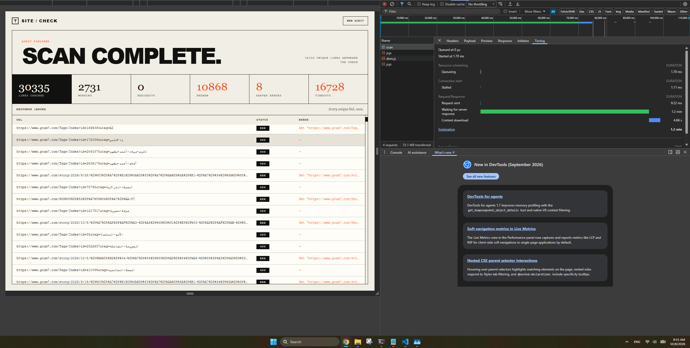

# SiteCheck

SiteCheck is a small Go web app that crawls a website and checks its links concurrently.

I built it mainly as a practical project while learning Go concurrency. The goal was to use goroutines, channels, worker pools, synchronization, and coordination in something more realistic than isolated exercises.



## What it does

You enter a website URL and SiteCheck:

- crawls pages from the same domain
- extracts links from HTML pages
- avoids checking the same URL more than once
- checks discovered links concurrently
- reports working links, broken links, server errors, and timeouts
- shows the results in a simple web interface

External links are checked, but their pages are not crawled further.

## How it works

The crawler uses a worker pool to process multiple URLs concurrently.

Each worker:

1. receives a URL
2. sends an HTTP request
3. records the response status
4. extracts links if the response is HTML
5. sends the result back to the coordinator

The coordinator keeps track of URLs that are waiting to be processed and requests that are currently in progress.

```text
Website URL
     |
     v
 Coordinator
     |
     v
 URL Queue
     |
     v
 Worker Pool
     |
     +---- HTTP request
     |
     +---- Status code
     |
     +---- Extract HTML links
     |
     v
 Page Result
     |
     v
 Coordinator
     |
     +---- Discover new URLs
     |
     v
 Report
```

A `seen` set is used to prevent duplicate URLs from being scheduled.

## Concurrency

The project uses several Go concurrency concepts:

- goroutines
- channels
- worker pools
- `sync.WaitGroup`
- mutexes
- bounded concurrency
- producer/consumer coordination
- dynamic work queues

One interesting part of the project was determining when the crawl had actually finished.

New URLs can be discovered while existing URLs are still being processed, so the crawler keeps track of outstanding work until:

```text
queue is empty
AND
outstanding requests == 0
```

Only then are the worker channels closed and the workers allowed to exit.

## Running locally

Clone the repository and install the dependencies:

```bash
go mod tidy
```

Run the application:

```bash
go run .
```

Then open:

```text
http://localhost:8080
```

Enter a URL such as:

```text
https://example.com
```

and start the scan.

## Tech

- Go
- `net/http`
- goroutines and channels
- `sync`
- [goquery](https://github.com/PuerkitoBio/goquery)
- HTML templates

## Notes

This is intentionally a small project focused on concurrency rather than a production-grade crawler.

Large websites can contain thousands of dynamically generated or parameterized URLs, so the number of discovered links can grow quickly.

A production version would likely need additional features such as:

- maximum crawl depth or page limits
- rate limiting
- robots.txt support
- request cancellation
- redirect tracking
- SSRF protection for public deployments
- persistent scan history

## Why I built it

I wanted a project where concurrency was actually useful rather than added just for practice.

A website crawler naturally has independent network requests that can run concurrently, while still requiring coordination around discovered URLs, duplicate detection, worker lifecycle, and shutdown.

That made it a good final project for practicing Go concurrency before moving on to other backend topics.
